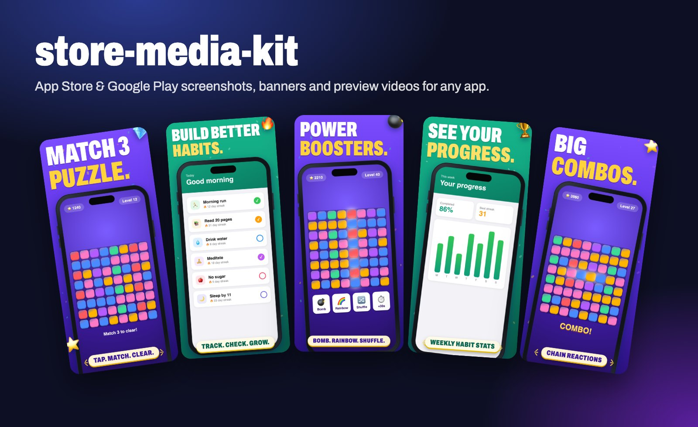
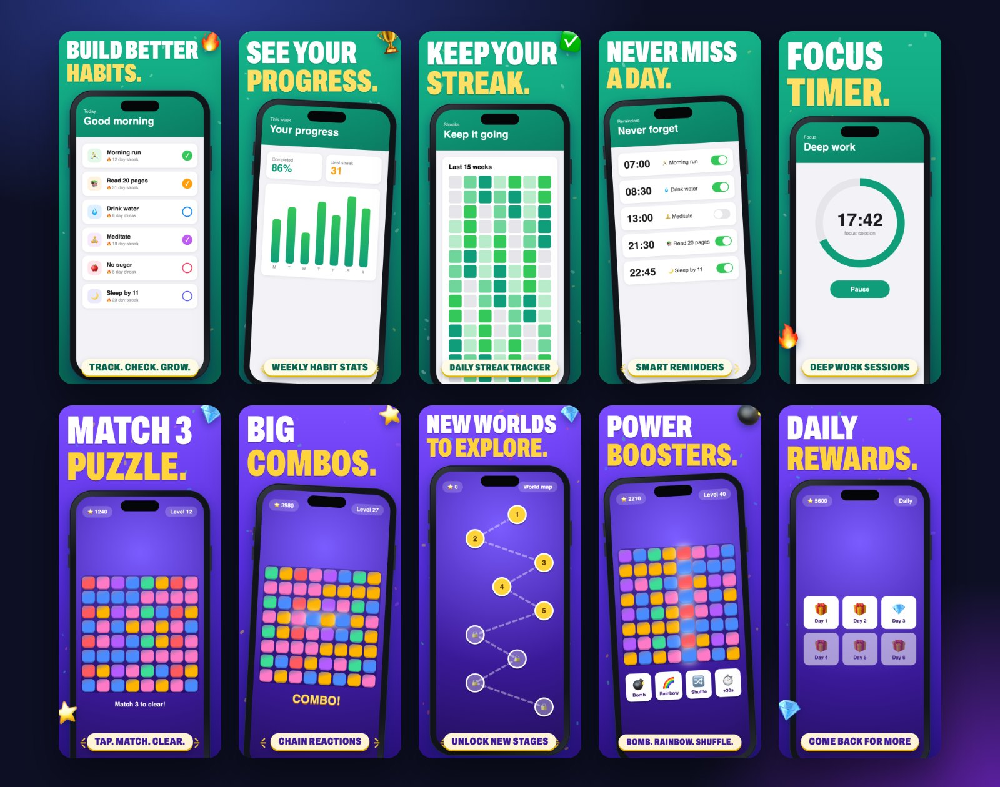
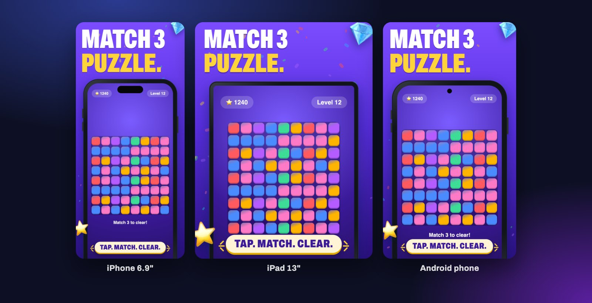
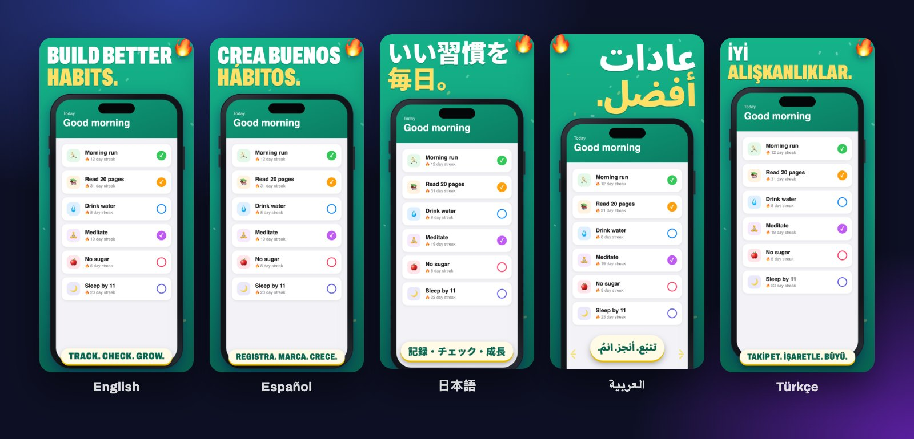
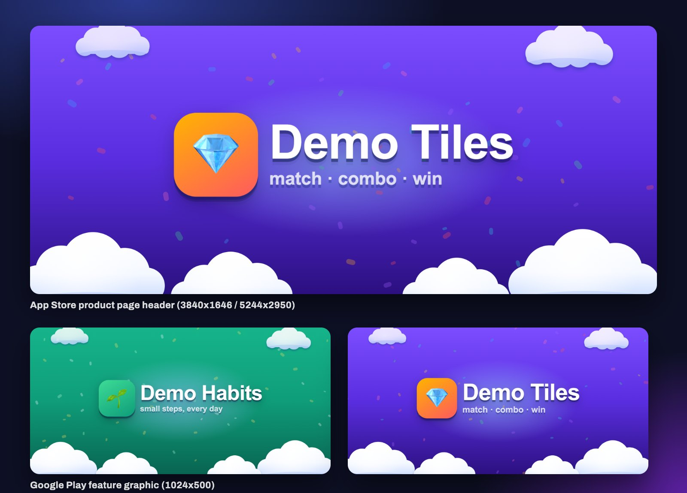
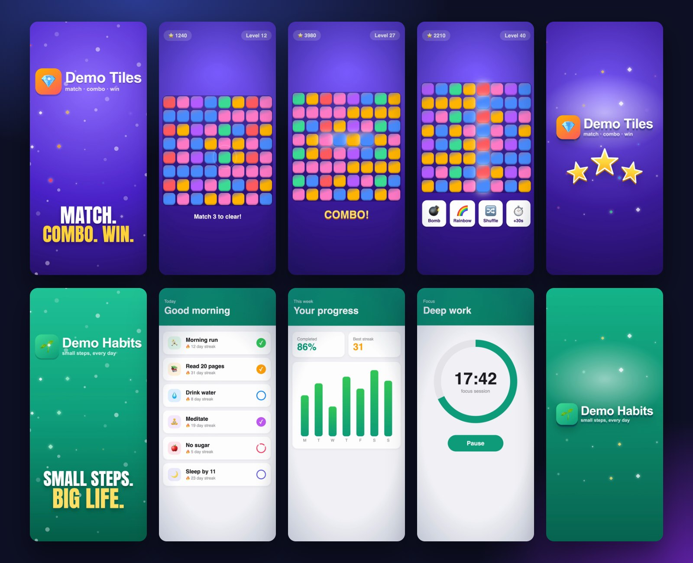

<div align="center">



# store-media-kit

**Store-ready screenshots, banners and preview videos for any app — App Store and Google Play,
in every language, from one small config file. Built to be driven by your AI assistant.**

[](LICENSE)


[Quick start](#quick-start) · [Use it with AI](#the-easy-way-let-your-ai-do-it) · [Examples](#examples) ·
[Prompts](docs/PROMPTS.md) · [Config reference](docs/MEDIA-JSON.md) · [Store specs](docs/STORE-SPECS.md) · [Türkçe](README.tr.md)

</div>

---

## What you get

| Output | Sizes | Store |
| --- | --- | --- |
| Screenshots with a bold keyword headline, your real app inside a device frame and a short caption | iPhone 6.9" **1320×2868** · iPad 13" **2064×2752** | App Store |
| The same screenshots for Android | phone **1080×1920** · 7" tablet **1200×1920** · 10" tablet **1600×2560** | Google Play |
| Product page header (logo on your brand background) | **5244×2950** · **3840×1646** | App Store |
| Feature graphic | **1024×500** | Google Play |
| Preview video: title → real app shots with tap ripples → logo end card, music fade | **886×1920** (App Preview) · **1080×1920** (Play / YouTube) | both |
| Upload + verification scripts (fastlane / App Store Connect) | — | both |

- Works for **games and non-game apps** alike. Your app's real captures, no mock-ups.
- **Every language**: headlines shrink to fit, Turkish `İ` and German `ß` uppercase correctly, Japanese,
  Korean, Chinese, Thai, Hindi, Arabic and Hebrew get proper fonts, right-to-left layouts flip.
- One `media.json` per app. Re-render everything after a caption change in seconds.
- Plain Python + headless Chrome for images, [Remotion](https://www.remotion.dev) for video. No accounts, no cloud.

## Examples

Two fictional demo apps ship in [`examples/`](examples) — a habit tracker and a tile puzzle game — so
you can try the whole pipeline before touching your own app.



**One design, every device** — iPhone, iPad and Android from the same config:



**Every language** — captions are per-locale JSON files; fonts and line heights adapt per script:



**Banners** — App Store header and Google Play feature graphic:



**Preview videos** — opening title, real app shots with tap ripples, end card
([tiles](docs/media/tiles-preview.mp4) · [habits](docs/media/habits-preview.mp4)):



---

## The easy way: let your AI do it

This repo is written so an AI coding assistant can run it end to end. The instructions it needs are
already here and are picked up automatically:

| Assistant | Reads |
| --- | --- |
| Claude Code / Claude | [`CLAUDE.md`](CLAUDE.md) |
| ChatGPT Codex, OpenAI agents, Aider, Jules, and most others | [`AGENTS.md`](AGENTS.md) |
| Gemini CLI / Gemini Code Assist | [`GEMINI.md`](GEMINI.md) |
| GitHub Copilot | [`.github/copilot-instructions.md`](.github/copilot-instructions.md) |
| Cursor | [`.cursor/rules/store-media-kit.mdc`](.cursor/rules/store-media-kit.mdc) |
| Any LLM / web chat | [`llms.txt`](llms.txt) (paste it or its link) |

Open your **app's folder** in your assistant, clone this repo next to it, and paste:

```text
Use store-media-kit (../store-media-kit, read its AGENTS.md first) to make the App Store and
Google Play screenshots for this app. Ask me for the app name, 5 key features and the brand colours,
then: capture clean screenshots from the simulator/emulator, write keyword-driven captions in
English, render them and show me the review sheet. Don't upload anything until I approve.
```

More copy-paste prompts — captions in 10 languages, the preview video, uploading, fixing a slide,
working from a plain web chat with no code access — are in **[docs/PROMPTS.md](docs/PROMPTS.md)**.

---

## Quick start

You need **Python 3.9+**, **Google Chrome** (or Chromium) and `pip install pillow`. Video also needs **Node.js 20+**.

```bash
git clone https://github.com/efe-efekan/store-media-kit.git
cd store-media-kit
pip install -r requirements.txt
python3 kit.py doctor                 # shows what is installed
```

Try an example:

```bash
python3 kit.py shots examples/tiles                       # every language, iPhone
python3 kit.py shots examples/tiles --device android_phone
python3 kit.py sheet examples/tiles                       # examples/tiles/out/sheet_iphone69.jpg
```

Start your own app:

```bash
python3 kit.py init ../my-app/store-media                 # creates media.json, texts/, raw/, art/
# 1. edit media.json (colours, slides, languages) and texts/en.json (captions)
# 2. put 5 clean screenshots of your app in raw/iphone69/en/01.png … 05.png   (docs/CAPTURE.md)
python3 kit.py check ../my-app/store-media                # catches missing files and too-long captions
python3 kit.py shots ../my-app/store-media
python3 kit.py sheet ../my-app/store-media                # one image to review everything
```

Optional, once: `python3 kit.py fonts` downloads the open Noto fonts for Japanese, Korean, Chinese,
Thai, Hindi, Arabic and Hebrew.

## Commands

| Command | What it does |
| --- | --- |
| `kit.py doctor` | Checks Python, Pillow, Chrome, Node, fonts, Xcode, adb, fastlane |
| `kit.py init <folder>` | New project from the template |
| `kit.py check <project>` | Validates config, captions, captures and store limits |
| `kit.py shots <project> [--device D] [--locale en,de] [--slides 1,4]` | Renders screenshots to `out/screenshots/<device>/<locale>/` |
| `kit.py sheet <project> [--device D]` | One contact sheet of every locale, for review |
| `kit.py header <project> [--size 5244x2950\|3840x1646]` | App Store product page header |
| `kit.py feature <project>` | Google Play feature graphic (1024×500) |
| `kit.py video <project>` | Sets up `<project>/video` (Remotion) and copies the media it needs |
| `kit.py fastlane <project> <dir> [--device D]` | Copies renders into fastlane's folder layout (App Store or Play) |
| `kit.py fonts` | Downloads non-Latin fallback fonts (once) |

Devices: `iphone69`, `ipad13`, `android_phone`, `android_tablet7`, `android_tablet10`.

## How a project looks

```text
my-app/store-media/
├── media.json          ← colours, slides, decorations, languages, video — the only config
├── texts/
│   ├── en.json         ← { "slides": [ { "line1", "line2", "pill" } ×5 ], "video": { "line1", "line2" } }
│   └── de.json …
├── raw/
│   ├── iphone69/en/01.png …    ← clean captures of your app (one English set serves every language
│   ├── ipad13/en/…               if your UI has no text, or add raw/<device>/<locale>/)
│   └── android_phone/en/…
├── art/                ← logo, small decorations (your own art)
├── video/              ← created by `kit.py video`
└── out/                ← everything rendered
```

Every field of `media.json` is explained in **[docs/MEDIA-JSON.md](docs/MEDIA-JSON.md)**.

## Writing captions that convert

Screenshot text is not indexed by store search, but it decides whether people tap *Get*:

- **Two short lines, keyword first.** "MATCH 3 / PUZZLE." beats "The most fun game you'll play".
- **No subtitle under the headline.** A short caption pill at the bottom is enough ("TAP. MATCH. CLEAR.").
- **One feature per slide**, each slide a *different* screen. Slide 1 is your best pitch.
- **No numbers that will change** (level counts, user counts) and no claims you can't keep.
- **Localise, don't translate**: write for each market's own search words. Ask your AI for this —
  see [docs/PROMPTS.md](docs/PROMPTS.md#2-captions-in-many-languages).
- Clean captures: no debug banners, no notifications, real but tidy data.

More: [docs/DESIGN-RULES.md](docs/DESIGN-RULES.md).

## Capturing your app

| Platform | How |
| --- | --- |
| iOS simulator | `capture/ios/still.sh <udid> raw/iphone69/en/01.png` (9:41, full battery) · video: `capture/ios/record.sh` |
| Android emulator / device | `capture/android/still.sh raw/android_phone/en/01.png` (demo-mode status bar) · video: `capture/android/record.sh` |
| Flutter (any platform) | integration test + `capture/flutter/record_flutter.sh` for frame-accurate clips with taps |
| Anything else | any 9:16-ish PNG works; `kit.py check` warns if the aspect ratio is off |

Details and tips: **[docs/CAPTURE.md](docs/CAPTURE.md)**.

## Preview video

```bash
python3 kit.py video examples/tiles        # creates examples/tiles/video and copies its media
cd examples/tiles/video
npm install
npm run studio                             # live preview in the browser
npm run render -- en                       # out/en.mp4       886×1920  (App Store App Preview)
npm run render -- en --preset play         # out/en-play.mp4  1080×1920 (Google Play / YouTube)
```

The video reads `media.json → video`: an opening image + the `texts/<locale>.json` title, then
**shots** (screen recordings, or plain screenshots with a slow camera move if you have no recordings
yet), optional tap ripples and zooms, an end card with your logo, and music. Apple wants 15–30 s;
the template computes the length from your shots. See [docs/MEDIA-JSON.md](docs/MEDIA-JSON.md#video).

## Uploading

**App Store** (screenshots via fastlane `deliver`, videos via the included Spaceship scripts):

```bash
python3 kit.py fastlane my-app/store-media my-app/fastlane/screenshots              # iPhone
python3 kit.py fastlane my-app/store-media my-app/fastlane/screenshots --device ipad13
cd my-app && bundle exec fastlane ios upload_screenshots_only                      # lanes: upload/Fastfile.snippet

export FASTLANE_USER=you@example.com                                               # your Apple ID
bundle exec ruby ../store-media-kit/upload/upload_previews.rb store-media en        # App Preview video
bundle exec ruby ../store-media-kit/upload/verify_media.rb store-media              # counts + processing state
```

**Google Play** (fastlane `supply`):

```bash
python3 kit.py feature my-app/store-media
python3 kit.py fastlane my-app/store-media my-app/fastlane/metadata/android --device android_phone
python3 kit.py fastlane my-app/store-media my-app/fastlane/metadata/android --device android_tablet10
cd my-app && SUPPLY_JSON_KEY=play-key.json bundle exec fastlane android upload_play_images
```

Google Play's promo video is a YouTube link: upload `out/en-play.mp4` to YouTube and paste the URL in
Play Console. The App Store product page header has no API yet — upload it in App Store Connect and
check it with *Device Preview → iPhone*.

Store rules (sizes, counts, video length, formats): **[docs/STORE-SPECS.md](docs/STORE-SPECS.md)**.
Use UTF-8 for fastlane (`export LANG=en_US.UTF-8 LC_ALL=en_US.UTF-8`) when your texts are not plain ASCII.

## FAQ

**Windows / Linux?** Rendering works anywhere Chrome and Python run. iOS capture needs a Mac with
Xcode; Android capture works anywhere with `adb`.

**My UI has text in it — one capture per language?** Put localised captures in
`raw/<device>/<locale>/`. Without them, `raw/<device>/en/` is used for every language.

**Can I use my own device frame?** Yes: `"frame_png"` in `media.json` (see the config reference).
By default the kit draws its own phone and tablet frames, so no third-party artwork is needed.

**Can I change the layout?** Colours, tilts, decorations and device width are config. Deeper changes:
`kit/screens.py` is a single HTML/CSS template — easy for you or your AI to edit.

## Contributing

Issues and pull requests are welcome — see [CONTRIBUTING.md](CONTRIBUTING.md). Please keep the kit
dependency-light and test with `python3 kit.py check examples/tiles && python3 kit.py shots examples/tiles --locale en`.

## License

[MIT](LICENSE) for the code. Bundled fonts (Anton, Archivo, Fredoka, Fira Sans Extra Condensed) and the
downloaded Noto fonts are under the [SIL Open Font License 1.1](assets/fonts/LICENSES.md). The example
apps and their artwork are fictional and free to reuse. App Store, iPhone and iPad are trademarks of
Apple Inc.; Google Play and Android are trademarks of Google LLC. This project is not affiliated with
either company.
