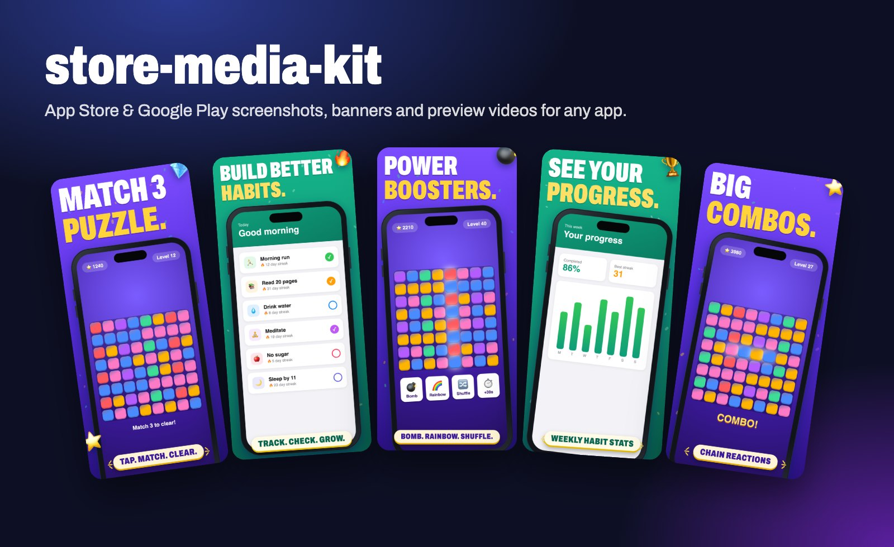

<div align="center">



# store-media-kit

**Her uygulama için mağazaya hazır ekran görüntüleri, banner'lar ve tanıtım videoları — App Store ve
Google Play, her dilde, tek bir ayar dosyasından. Yapay zeka asistanınızla kullanılmak için tasarlandı.**

[English README](README.md) · [Hazır promptlar](docs/PROMPTS.md) · [Ayar rehberi](docs/MEDIA-JSON.md) · [Mağaza ölçüleri](docs/STORE-SPECS.md)

</div>

---

## Neler üretir

| Çıktı | Ölçü | Mağaza |
| --- | --- | --- |
| Büyük anahtar kelimeli başlık + cihaz çerçevesinde gerçek uygulama + kısa alt yazı | iPhone 6.9" **1320×2868** · iPad 13" **2064×2752** | App Store |
| Aynı görseller Android için | telefon **1080×1920** · 7" tablet **1200×1920** · 10" tablet **1600×2560** | Google Play |
| Ürün sayfası header'ı (marka zemininde logo) | **5244×2950** · **3840×1646** | App Store |
| Öne çıkan görsel (feature graphic) | **1024×500** | Google Play |
| Tanıtım videosu: başlık → dokunma halkalı gerçek kullanım → logolu bitiş, müzik kısılarak | **886×1920** · **1080×1920** | ikisi de |
| Yükleme ve doğrulama script'leri (fastlane / App Store Connect) | — | ikisi de |

- **Oyunlar ve oyun dışı uygulamalar** için. Uygulamanın gerçek ekranları kullanılır, sahte tasarım yok.
- **Her dil**: başlıklar kutuya sığacak şekilde küçülür; Türkçe `İ` doğru büyür; Japonca, Korece, Çince,
  Tayca, Hintçe, Arapça ve İbranice için doğru fontlar gelir; sağdan sola dillerde düzen aynalanır.
- Uygulama başına tek `media.json`. Bir yazı değişince her şeyi saniyeler içinde yeniden üretirsiniz.

## En kolay yol: yapay zekaya yaptırın

Bu repo, bir yapay zeka asistanının baştan sona çalıştırabileceği şekilde yazıldı. Gereken talimatlar
hazır ve asistanlar bunları kendiliğinden okur:

| Asistan | Okuduğu dosya |
| --- | --- |
| Claude Code / Claude | [`CLAUDE.md`](CLAUDE.md) |
| ChatGPT Codex, OpenAI ajanları, Aider, Jules ve çoğu araç | [`AGENTS.md`](AGENTS.md) |
| Gemini CLI / Gemini Code Assist | [`GEMINI.md`](GEMINI.md) |
| GitHub Copilot | [`.github/copilot-instructions.md`](.github/copilot-instructions.md) |
| Cursor | [`.cursor/rules/store-media-kit.mdc`](.cursor/rules/store-media-kit.mdc) |
| Web sohbeti (ChatGPT, Gemini, Claude.ai) | [`llms.txt`](llms.txt) (içeriğini ya da linkini yapıştırın) |

Asistanınızda **uygulamanızın klasörünü** açın, bu repoyu yanına klonlayın ve şunu yapıştırın:

```text
store-media-kit'i kullan (../store-media-kit, önce AGENTS.md'yi oku) ve bu uygulama için App Store ve
Google Play ekran görüntülerini hazırla. Bana uygulamanın adını, öne çıkan 5 özelliğini ve marka
renklerini sor; sonra simülatörden/emülatörden temiz ekran görüntüleri al, anahtar kelime odaklı
başlıkları önce İngilizce ve Türkçe yaz, üret ve inceleme sayfasını göster. Ben onaylamadan hiçbir şey yükleme.
```

Daha fazla hazır prompt (10 dilde başlık, tanıtım videosu, yükleme, tek bir görseli düzeltme, kod
yazamayan web sohbetiyle kullanım): **[docs/PROMPTS.md](docs/PROMPTS.md)**.

## Elle kullanım

**Python 3.9+**, **Google Chrome** ve `pip install pillow` yeterli; video için **Node.js 20+**.

```bash
git clone https://github.com/efe-efekan/store-media-kit.git
cd store-media-kit
pip install -r requirements.txt
python3 kit.py doctor                                 # neler kurulu, neler eksik

python3 kit.py shots examples/tiles                   # örnek: bütün diller, iPhone
python3 kit.py sheet examples/tiles                   # hepsini tek görselde gör

python3 kit.py init ../uygulamam/store-media          # kendi projeniz
python3 kit.py check ../uygulamam/store-media
python3 kit.py shots ../uygulamam/store-media --device iphone69
python3 kit.py shots ../uygulamam/store-media --device ipad13
python3 kit.py shots ../uygulamam/store-media --device android_phone
python3 kit.py header ../uygulamam/store-media --size 3840x1646
python3 kit.py feature ../uygulamam/store-media
python3 kit.py video ../uygulamam/store-media && cd ../uygulamam/store-media/video && npm install && npm run render -- tr
```

Bütün komutlar, yükleme adımları ve SSS için İngilizce [README.md](README.md) dosyasına bakın.

## Başlık yazma kuralları

- **İki kısa satır, anahtar kelime önde.** "ARABA PARK / BULMACASI." gibi.
- **Başlığın altına alt metin yok**; alttaki kısa yazı (pill) yeterli.
- **Her görsel farklı bir ekran ve özellik** göstersin; ilk görsel en güçlü mesajınız.
- **Değişebilecek sayı yazmayın** (bölüm sayısı, kullanıcı sayısı), kanıtlayamayacağınız iddia yok.
- **Her dili o pazar için yazın**, birebir çeviri değil.

Ayrıntılar: [docs/DESIGN-RULES.md](docs/DESIGN-RULES.md).

## Lisans

Kod [MIT](LICENSE) lisanslı: ticari projeler dahil özgürce kullanabilir, değiştirebilir ve
dağıtabilirsiniz. Fontlar [SIL Open Font License 1.1](assets/fonts/LICENSES.md) ile gelir. Örnek
uygulamalar ve görselleri hayalidir. App Store, iPhone ve iPad Apple Inc.'in; Google Play ve Android
Google LLC'nin markalarıdır. Bu proje iki şirketle de bağlantılı değildir.
